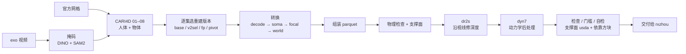

# Tier 3 重建流程总览

本文是 2026-10-22（EDT）时的快照，只在用户要求时更新；文件名里的日期是首版日期。数字出自
[10-10 交接](handoff-tier3-2026-10-10.md)、[动力学交接](handoff-tier3-dynamics-2026-10-14.md)、
[朝向交接](handoff-tier3-rotation-2026-10-16.md)、[gb5 归因](handoff-tier3-rotation-2026-10-21-attr.md)、
[gb5 交付报告](delivery-tier3-gb5_best_dr2s_dyn7-2026-10-21.md)和各脚本的 docstring；标「推断」的没有核实。脚本都在
`stages/recovery/tier3/`。版本日期沿用交付记录里的 L40S 时间（CST，比美东早 12 小时）。

写作时的状态：交付版是 `tier3_cari4d_gb5_best_dr2s_dyn7`（10-21 03:05 CST，即 10-20 15:05 EDT），10-21 原地补了 ep01 的依靠方块
（`42f01f0`）。**10-21 起 Tier 3 重建由 rxzhou 接管**：计划在 `track2/p1-training` 的 `agent-doc/plan-t3takeover*-2026-10-21.md`，
代码分支 `track2/t3recon-rx` 从 `42f01f0` 开出。本文描述的是接管时的流程；此后的改动以 rxzhou 的分支为准。

## 1. 目标与输出

Tier 3 的赛制是自带重建：组委会只给 30 段单目 exo 视频，每段一个人搬动一个物体，参考轨迹要从视频里恢复。我们的输出是每集一份
与 Tier 2 同 schema 的 parquet，内容是人体 SOMA 参数和物体 6D 位姿，外加我们自己算的支撑面。rxzhou 用它做重定向和
G1 + Dex3 策略训练；计分对照的是 Tier 1 的干净物体轨迹，比较在官方网格自己的局部坐标系里进行。

## 2. 规则约束

可以使用的输入有三样：exo 视频、官方物体网格，以及发布地面文件里的 `plane` 字段（静态场景标定）。Tier 1 和 Tier 2 的任何轨迹都不用，
人体轨迹也算在内；官方 `support_surface/` 不用，它是放在干净物体每次静止位置下面的碰撞垫，等于泄露静止位置；地面文件里由干净人体算出的
`foot_plane_dist_stats` 也不读。流程必须全自动：Kaggle 规则禁止对测试数据人工标注，检测不到物体的集直接失败，不补框。

这些约束写进了代码。`tier_guard.forbid_lower_tiers()` 按真实路径拦截低档位文件（软链接也拦），`t3_inputs.py` 是读取地面文件的唯一入口。
灰区有两个，至今没问组委会：`ground_plane` 文件只出现在 Tier 1、2 目录，我们按内容判断它是静态标定在用；官方网格可用属于规则解读。

官方 FAQ 在 2026-10-19 新增一条（FAQ PDF 提交 `d9d6bf04`）：Tier 3 没有相机标定，可以用 Tier 1 数据的第一帧计算对齐，前提是 Tier 1
的 caption 不在 Tier 3 的其他地方使用（原文 "provided the Tier 1 caption isn't used in Tier 3 otherwise"）。本流程没有用到这条，仍然不读任何 Tier 1 数据，比 FAQ 允许的更严。上面两个灰区这条 FAQ 没有涉及。

## 3. 流程全景

掩码和 CARI4D 在 GPU 上跑，单集约 26 分钟（ep20，默认模式）到 1.2–2.0 小时（每帧配准）；转换、后处理和检查都在 CPU 上跑。
机器是 L40S，部署只走 `deploy_l40s.sh`。

## 4. 重建

### 4.1 掩码

`t3_masks.py` 先用 Grounding DINO 在多帧上挑提示帧，再用 SAM2 分割整段，经过自检（检测框一致、不外溢）后打包成 h5。最初按标签选物体，
画面里有多个相似物体时会挑错：ep01 选成了三脚架，ep06 选成了远处的显示器，ep10 的白桌被当作支撑面丢掉。10-10 起改为利用「人在搬的
那个才会动」：检测框按 IoU > 0.4 连成轨迹，有轨迹被挪动过（平移 ≥ 0.15 倍对角线）时只在被挪动的轨迹里选。重跑后这三集都选对了，
30 集掩码自检全部通过。

### 4.2 CARI4D 的八个阶段

| 阶段 | 做什么 |
|---|---|
| 01 depth、02 export | 深度估计，导出 CARI4D 输入 |
| 03 human_initialization、04 depth_alignment | 人体 MHR 初值，人与场景的深度对齐 |
| 05 object_pose | FoundationPose 逐帧给物体位姿（每帧约 200 个候选，打分取一个） |
| 06 coconet | CoCoNet 联合优化人和物体，以 05 的位姿为初值 |
| 07 refinement | 后优化，默认冻结物体旋转，只调平移 |
| 08 render | 渲染核对视频 |

物体朝向由 05 和 06 决定，07 不再改动旋转。05 最慢，每帧配准模式下单集 47–92 分钟。

### 4.3 逐集选重建版本

同一集有几种跑法，各自擅长不同的集：

- `base`：先配准再跟踪，即 CARI4D 默认模式。
- `v2sel`：用新选物规则重跑掩码，共 8 集。
- `fp`：FoundationPose 每帧重新配准，用在跟丢严重的集上。
- `pivot`：ep19 手杖专用，握点取手掌中心、杖尖取掩码最远端，由杖长解出朝向。

判据是跟丢比例，即物体剪影与掩码 IoU（两边各膨胀 5 px）过低的帧所占比例，只用 Tier 3 信号。每集取跟丢比例最低的版本，得到 `best`：
base 12 集、v2sel 4 集、fp 13 集、pivot 1 集，ep28 仍判为可疑。每帧配准在难集上效果明显，例如 ep03 的跟丢比例从 0.259 降到 0.041，
ep27 从 0.713 降到 0.218（10-12 改判据之前的口径）。选择记录在 `tier3_cari4d_f830_best.selection.json`，此后每一代版本沿用这张表，
只换转换来源。gb5 起，13 个 fp 集的 05 步初始朝向改由时间线选择器挑（见第 9 节），其余 17 集与 gb4 逐列相同。

## 5. 转换到世界系

### 5.1 转换步骤（`t3_convert_ep.py`）

- `decode`：人体身份参数取每集中位数固定，因为下游只读第 0 帧的身份；物体位姿换到官方网格自己的局部坐标系。
- `soma`：MHR 顶点经 PoseInversion 拟合到 SOMA；`residual` 另行复核拟合误差。
- `focal`：换成标定内参。点映射 M 保持每个点的像素位置不变，深度随 f 缩放；物体对映射后的表面做 Kabsch，人体用 PoseInversion 重新拟合。
- `world`：做地面校正和机位配准，人体与物体一起做相似变换。
- `assemble`：写 parquet 和元数据。

focal 步在 10-18 改过一次。之前物体按点映射移动，人体只随骨盆刚体移动，两者不一致，手持物体的集里手离物体 1–6.5 cm。改成两者各自
拟合到同一个点映射后，标了接触的帧回到 18133，f830 版是 18263。这是 gb3 到 gb4 的唯一区别。

### 5.2 世界系

机位分三组：主机位 24 集，第二机位 5 集（ep12/14/16/25/28），侧机位只有 ep21。三组都用 GB 内参（f 866.3、cx 701.8、cy 531.1，来自
rxzhou 的 `kt_gb.json`）。地面自己能定出 cy 约 523–531，f 和 cx 地面定不住。

地面校正（`t3_floor_fit.py`）把重建地面的法向转到发布法向，再按偏移缩放，gb4 主机位的倾角是 0.964°、尺度 0.982。第二机位靠两台相机
互相检测对方的三脚架完成配准（偏航 181.53°，尺度 0.949）。侧机位 ep21 自己的地面接触点几乎共线，拟不出地面，改用画面边缘的两台三脚架
配准（偏航 84.94°），内参按同型号相机的旁证采用 GB，属于证据不足下的决定，交付记录里写明了做过哪些检验。

世界系出问题时，表现是物体悬空或穿地。最早把相机系当世界系，地上的物体离地 11–22 cm，越远越高；之后依次加了焦距统一（f830）、
地面校正、身体随场景缩放、机位配准，最后换成 GB 内参。10-20 用户定世界系视为已完成，不再投入：榜上 MPPE 的大头是策略没跟住自己的
参考，整体偏航 ±5° 只让榜上变 3–4 cm。gb5 沿用 gb4 的地面拟合与相机配准。第二机位与侧机位共 6 集的手工配准没有复核，记为已知。

## 6. 物理后处理

### 6.1 支撑面

`t3_support.py` 把物体的静止段（15 帧内离中位数不超过 5 cm）中离地的部分作为候选，用 MoGe 判断物体下面有没有表面并按表面分组，
高度取物体自己的；同一表面上没离开过的相邻静止段合成一次放置。交付时由 `gate/t3_support_usda.py` 写成官方同格式的 usda，逐集残差不超过
1e-7 m。现用 v2；扩大范围的 v3 被用户否决，因为熨斗伸出了桌沿，碗反而变小。

支撑面必须和数据一起交：rxzhou 的训练前门槛要判物体是否落在支撑面上，只按地面判时，放在桌上的物体必然算悬空（ep3/6/7/20/25）。
用我们的支撑面判，交付版 30/30 通过。

**依靠方块（10-21，`bc1d566`）。** 斜靠在别的东西上的物体，原支撑面里没有它靠着的那件，仿真开局就倒：ep01 的吸尘器靠在吧凳上，
rxzhou 的逐帧终止分析把它归为「立着的吸尘器倒了」。`gate/t3_lean_support.py` 接在 `chain_check.sh` 写 usda 之后运行：找没人拿着、
靠自己站不住（准静态倾倒超过 10°）的段，在 MoGe 看到的依靠面高度上贴着物体放一个碰撞方块。MoGe 只给高度和大小，位置取物体自己的
（ep01 的凳面在 MoGe 里离吸尘器 0.23 m）。方块在别的帧被物体穿入时不写。gb5 只有 ep01 写了两个方块（`support_lean_0`、`support_lean_1`，
凳面高约 0.60 m）；ep28 的三个候选方块都被刮水器穿入 2 cm，没有写。只换了 ep01 的 usda，门槛复检 30/30，与更新前逐行相同。

### 6.2 dr2s：沿视线修深度

静止物体的最低点要贴住地面或桌面。最初的做法（`best_hm`）是直接竖直平移，三分之一的帧因此被挪离画面，IoU 从 0.810 降到 0.737。
单目重建对物体方向判断得准、对距离判断得差，深度误差约为距离的 1.7%，所以修正应该沿视线做。`t3_depth_post.py` 沿每帧自己的视线
按深度比 k 移动物体，像素位置不变；k 限幅在 1 ± K_CAP 内，剩下的才用竖直平移补。限幅是为桌面设的：从 1.39 m 高的相机看桌面，
视线几乎水平，沿视线挪几厘米高度要走几十厘米深度。静止段之间按帧插值 k，手持帧保留物体自己的深度，人体随物体移动
（`--move-human=3d`）。修正后 IoU 回到 0.807。

### 6.3 dyn7：动力学后处理

开始做这一步，是因为 best_hm 上训不动：rxzhou 的五集 MP-SR 全是 0。机器人层参考里，没人碰的物体在漂、在抖、在翻。

检查器 `gate/t3_dynamics_check.py` 读机器人层 parquet，每帧先判被碰、支撑还是悬空，再判加速度、漂移、力矩和转角跳变。Tier 1 和
Tier 2 只用来读误报率（1.8%、1.4%），不用来调参数。

修复器 `t3_dynamics_post.py` 只改物体，分四步：

1. 处理对称：从网格自动找出等价旋转（球棒、碗、书、零食箱、滑板、编织篮），逐帧取离上一帧最近的一个。
2. 锁定：没被碰、又在静止段里的连续帧只保留一个位姿。
3. 被碰段：两端的偏移在 0.5 s 内余弦过渡到 0，段中保持原值。
4. 防穿地。

锁定段以外，每帧和输入的朝向差不超过 40°，这一条写成了断言。违规帧从 hm 的 6207 降到 gb4 的 2105。

## 7. 检查与交付

每个交付版带一份 `DELIVERY.md`，由 `t3_delivery_report.py` 从各项结果文件生成，数字不手抄。自检清单是 10-15 定的 13 项，覆盖数据契约、
改动审计、逐帧画面对齐、动力学、手和物体、来源记录和看图；合成轨迹空跑与幂等性、每帧可信度这两项的工具还没写。rxzhou 的训练前门槛
在我们这边用 CPU 复跑：用我们的支撑面 30/30，只按地面 25/30。后处理运行时会核对实际加载的代码与部署清单一致。

流水线一律停在交付前，换不换交付版由用户决定，因为交付会改变 rxzhou 读到的数据。放行看两样：登记过的机器闸门不比上一交付版差
（超出的项要逐项归因），用户整批看图，旧版对、新版错的帧不超过 10%。

| 指标 | gb4 | gb5 |
|---|---|---|
| 动力学违规帧（占比） | 2105（9.2%） | 1779（7.7%） |
| 轮廓 IoU 各集中位数的均值（29 集，不含 ep28） | 0.805 | 0.809 |
| 标了接触但手离物体超过 3 cm | 0.92% | 0.94% |
| 训练前门槛，用我们的支撑面 | 30/30 | 30/30 |

gb5 的闸门 `ATTRIBUTE M5 M6` 已归因：变化跟着选择器改过的朝向段走，M5 的增量几乎全来自 ep11 右手 634–693 帧（gb4 已有）。用户整批看图
77 帧，旧对新错 3/75（连同 gb4 好一些 7/75）。gb5 闸门第一次运行时，`t3_align_check.py` 不认 gb5 的转换目录，报错被链和自检吞掉；
`e909298` 修复，并让两处在对齐结果缺失时失败。

## 8. 版本演进

| 版本 | 日期 | 相对上一代改了什么 |
|---|---|---|
| `f830_floor` | 10-10 | 主机位焦距统一为 830，加地面校正 |
| `f830_simreg` | 10-11 | 人体随场景缩放（修脚陷地的一部分），第二机位配准 |
| `f830_best` | 10-13 | 逐集选重建版本（base / v2sel / fp / pivot） |
| `f830_best_hm` | 10-13 | 竖直高度后处理，手持段人体跟随；第一个带支撑面的交付 |
| `best_dr2s_dyn7` | 10-16 | 高度后处理换成沿视线的 dr2s，再加 dyn7 |
| `gb_best_dr2s_dyn7`（gb3） | 10-17 | 三台相机都用 GB 内参，地面与配准重算 |
| `gb4_best_dr2s_dyn7` | 10-18 | focal 步人体和物体各自拟合（手物偏差修正）；10-21 被取代，原地保留 |
| `gb5_best_dr2s_dyn7` | 10-21 | 13 个 fp 集的 05 步初始朝向改由时间线选择器挑（`BETA` 0.5），重跑 06–08 与整条链；当前交付版，同日补依靠方块 |

所有版本登记在 `versions.json`，被取代的归档到 `runs/archive`。rxzhou 已经复制过的版本不做同名替换，修正版另起名，所以 gb3 修正后叫 gb4。

## 9. 朝向翻转与方案 (1)

### 9.1 问题与定位

物体会整段翻转：ep04 球棒在第 313/509/669 帧头尾颠倒，ep03 杯子在第 451 帧上下颠倒，后处理管不到。单帧跳变出在 06 CoCoNet；
05 FoundationPose 本身是连续的，但会整段落在错误的分支上，而 CoCoNet 跟着 05 给的初值走。

只靠单帧信息分不出来，物体在画面里只有 1200–4200 个像素，杯把这类决定朝向的部件常被手挡住。下面几种办法都试过，都不行：
卡尔曼平滑会锁在错误的一侧；FoundationPose 打分网络给 16 个候选几乎同分；手的几何约束太弱；零样本像素特征接近乱猜。
10-16 的初值试点证明，换了初值之后 CoCoNet 的朝向会跟着变对，所以从 05 修是对的方向。

### 9.2 方案 (1)：全时间线选候选

05 的候选池里每帧都有朝向正确的候选，问题就变成在整段时间上挑一条合理的路径。具体做法：

1. 05 步重跑，保存每帧的全部候选（`t3_fp_dump.sh`，两路并行，约 16 h GPU）。
2. `t3_fp_select.py` 用 Viterbi 选路径。一元项是 −(FoundationPose 分数的 log-softmax + 5 × 剪影 IoU)，二元项是
   转角 / (10° × 间隔) + 平移 / (5 cm × 间隔)，转角按物体对称性取最小。
3. 选完后重跑 06–08，再走 gb4 的转换与后处理链。
4. 自动闸门判三项：G1 答案帧上的朝向，G2 跳变数，G3 与画面的吻合程度。

10-19 的试点里 ep04 通过，ep03 失败。失败的机制已经查清：ep03 开头静止段里 FoundationPose 本来是对的，对的候选也在池子里，
但单帧打分把它排在第二，选择器靠 0.02–0.22 的分差把它改错了；错误路径在三项代价上都更便宜，调权重修不了。

于是加了一个锚：默认保留 FoundationPose 自己的选择，只有整段时间线明显偏好另一个朝向时才改（`ANCHOR_DEG = 24`）。锚的权重
`BETA` 由 10-20 的 A/B 定为 0.5：取值 {0, 0.1, 0.2, 0.3, 0.5}，在 ep03、ep04、ep13 上各走完整条链，裁判是运行前登记的自动指标（全轮廓
IoU 的均值，差 0.005 以内取跳变最少的）。0.2、0.3、0.5 打平，0.5 跳变最少。答案帧只在胜出值定下后做验收，不回头改值。早先的 0.316 是用 7 个答案帧框出来的，已作废。

### 9.3 推广与交付

`t3_sel_full.sh gb5` 把选择器推广到 13 个 fp 集（ep19 不纳入），产出 gb5。gb5 是分段对错：有的段纠正了 gb4 的翻转，有的段反而改错。
试过按段从 gb4、gb5 取初值拼成 gb6，预测在答案帧上只比 gb5 多对 2 帧，还会在 ep13 拼出静止中的翻转；静止时的朝向没有自动判据，
用户定不跑，回到整批二选一，交付 gb5。

## 10. 已知问题

- ep28 刮水器重建失败，手离物体 20–40 cm，放在 `_suspect`，用户定搁置；ep29 脚与行李箱之间有缺口。
- ep11 书：人手贴着书，但重定向让机器人右手离书 3–5 cm（gb4 41 帧，gb5 52 帧，增量来自 CoCoNet 重优化人体，与选择器无关）。
  问题在重定向一侧，原因未核实。
- ep16 喷壶第 105–125 帧手离瓶约 10 cm，CARI4D 原始结果就是这样。
- gb5 分段对错，gb4 更好的段：ep01 331–405 帧、ep02 开头、ep13 第 720 帧、ep03 第 117 帧的杯把。两版都错的段：ep02 815–979 帧
  （篮子被挡）、ep13 第 189/209/769 帧跟丢与第 921 帧朝向、ep03 第 563 帧杯把、ep11 第 889/900 帧、ep28 第 725 帧之后。
- ep19 第 815–831 帧是腿挡住手杖时的重建乱转，不是靠物，没有方块；需要通用的遮挡段插值，未做。
- 闸门的跳变计数把绕近似对称轴的自旋也算进去（如 ep17 地上静止段），这部分看图看不出来。
- 主机位脚陷地约 −4 cm 来自 CARI4D 自身，交给机器人腿部 IK 处理（用户与 rxzhou 一致）。

## 11. 待决

- 两个规则灰区（`ground_plane`、官方网格）是否去问组委会。
- 自检还缺的两项工具：合成轨迹空跑、每帧可信度。
- rxzhou 的打包白名单要加入 `tier3_cari4d_gb5_best_dr2s_dyn7` 与 `_suspect`（写在朝向交接的交付节）。
- 以上各项 10-21 起由 rxzhou 决定。
