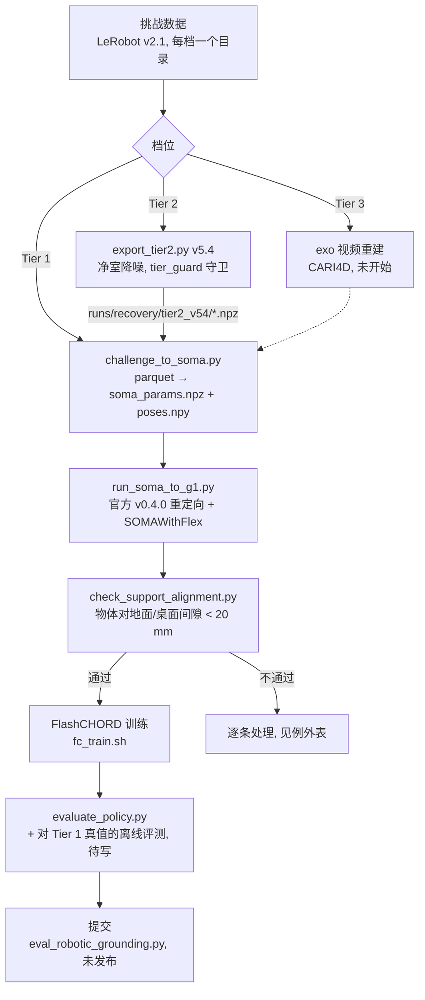

# 进度报告与流程文档：Track 2 数据 → 策略管线

**Owner:** rxzhou（执行：rxzhou + coding agent） | **Last Updated:** 2026-09-25 | **Review Cadence:** 每周一次，封榜前最后一周改为每天

> 本文件在 `agent-doc/`，是进度记录与流程草稿，**不作为事实来源**。数字均给出产出它的
> 结果文件（`results/*.txt`，头部带脚本 md5 与运行时间）。框架经团队确认后迁入 `docs/`。
> 架构层面的决定见 [`docs/architecture-current.md`](../docs/architecture-current.md) 与
> [`docs/adr/`](../docs/adr/)。

## 一句话进度

两个档位共 60 条序列已转成训练可用的参考轨迹（Tier 1 28/30、Tier 2 27/30 通过对齐检查）；
Tier 2 物体轨迹降噪从 ADD-AUC 0.423 做到 0.707（合规净室版）；训练栈 FlashCHORD 已跑通，
**还没有一个完整训练出来的策略**。下一阶段的重心是策略训练。

封榜：2026-11-04 17:00 EST（挑战页原文；规则草案 PR #164 里另有 11/5、11/10 两个冲突日期，待组委会确认）。

---

## Purpose

把挑战给的第三人称人-物交互轨迹，变成 Unitree G1 + Dex3 在官方仿真里能执行的策略，
按档位分别提交评测记录。三档都对照干净多视角物体轨迹打分（AUC / SP-SR / MP-SR / MPPE）。

## Scope

| 包含 | 不包含 |
|---|---|
| Tier 1、Tier 2 的全流程：转换 → 降噪（仅 Tier 2）→ 重定向 → 训练 → 本地评测 → 提交 | Track 1、Track 3 |
| Tier 3 的计划（从 exo 视频重建） | Tier 3 的实现（尚未开始） |
| 合规机制（档位隔离） | 改机器人模型或仿真器（规则禁止） |

## RACI

只写角色，不写成员背景。

| 步骤 | Responsible | Accountable | Consulted | Informed |
|---|---|---|---|---|
| 数据转换与重定向（批处理） | coding agent | rxzhou | — | 队友 |
| Tier 2 降噪方法研发与选型 | coding agent | rxzhou | jev（合规/结论核对） | 队友 |
| 合规判断（档位隔离、规则解读） | coding agent | rxzhou | 组委会（邮件） | 队友 |
| 策略训练与调参 | coding agent | rxzhou | — | 队友 |
| 共享 4090 的占用 | rxzhou | rxzhou | 共用该机器的队友 | 共用该机器的队友 |
| 租卡（L40S）与预算 | rxzhou | rxzhou | 队友 | 队友 |
| 仓库结构、分支与 commit | rxzhou | 仓库维护者（队友） | coding agent | 队友 |
| 榜单提交（每周 5 次上限） | rxzhou | rxzhou | coding agent | 队友 |

## Process Flow

## Detailed Steps

所有命令在 Mac 上执行，经 `scripts/dev/remote` 同步到训练机并在仓库根目录运行。

### Step 1：数据转换

- **Who**：coding agent
- **When**：数据集更新或转换器改动后
- **How**：`python3 stages/retarget/challenge_to_soma.py --tier N --episode E [--object-poses <npz>]`
  - 人体参数带逐帧 `bone_length_flexibles`（官方读取器不读它，丢掉会让关节整体偏 13.5 mm，见 `results/bone_flex_probe.txt`）
  - 物体位姿保持 OpenCV 世界系；不可见帧沿用上一有效位姿
  - 源帧率从 timestamp 算出，写进 `v2d_meta.json`
- **Output**：`runs/motion_src/tier{N}/<seq>/`，support 复制到 `runs/motion/tier{N}/whole_body/reconstructed_stage/`

### Step 2：Tier 2 物体轨迹降噪（仅 Tier 2）

- **Who**：coding agent
- **When**：降噪方法或参数变更后
- **How**：`python3 stages/recovery/export_tier2.py v5.4`，核对 `python3 stages/recovery/check_tier2_export.py tier2_v54`
  - 进程启动即 `forbid_tier1()`：任何读 Tier 1 的动作都会抛错
  - 参数来自 `runs/recovery/cleanroom_params.json`，由 `cleanroom_params.py` 只用 Tier 2 + 物理常识推出
- **Output**：`runs/recovery/tier2_v54/episode_*.npz`（OpenCV 系，全长帧数，含来源与 md5）

### Step 3：重定向与对齐检查

- **Who**：coding agent
- **When**：Step 1/2 产物更新后
- **How**：`stages/retarget/batch.sh [1] [2]`（环境变量 `T2_POSES=tier2_v54` 指定 Tier 2 位姿来源）
  - 单条逻辑在 `one.sh`：转换 → 一次性 CPU 容器里跑官方 `soma_to_g1`（经 `SOMAWithFlex` 包装）→ 对齐检查
  - 并发 3、每容器 4 线程（22 核共用机器，留一半给别人）
- **Output**：`runs/motion/tier{N}/whole_body/soma/sequence_id=*/robot_name=g1/data.parquet`；汇总 `runs/logs/batch/summary.tsv`

### Step 4：策略训练（下一阶段重点）

- **Who**：coding agent
- **When**：Step 3 通过的序列
- **How**：`V2D_GPU=1 scripts/dev/in-flash-chord /repo/stages/policy/fc_train.sh <parquet> <world_count> <total_steps> <out_dir> [hydra 覆盖]`
  - 官方 G1 配方：FlashSAC，3.5 亿环境步，2048 世界，replay buffer 1000 万条
  - 4090 上 buffer 1000 万会爆内存，只能缩到 100 万跑；满配需要 48 GB 卡
- **Output**：`runs/flash_chord/<run>/policy_<steps>.safetensors`

### Step 5：评测

- **Who**：coding agent
- **How**：`python scripts/evaluate_policy.py evaluation.checkpoint=<ckpt> evaluation.world_count=<N> evaluation.metrics_output=<json>`
  - 输出 add_auc、mppe_cm、spider_sr（≈SP-SR）、maniptrans_sr（≈MP-SR）、终止原因分解
  - **缺口**：它对照的是策略自己的参考轨迹。Tier 2/3 策略的参考带噪，本地分数与官方（对照干净真值）不同口径。需要一个对 Tier 1 真值的离线评测，仅用于分析
- **Output**：`<ckpt>.metrics.json`

### Step 6：提交

- **Who**：rxzhou
- **How**：官方要求用 `eval_robotic_grounding.py` 生成提交物，**脚本尚未发布**。每周 5 次，最后三天不限
- **Output**：Kaggle 上按档位 × 指标的 12 个竞赛（目前未登录状态下全部 404）

## Exceptions and Edge Cases

| 情况 | 怎么处理 |
|---|---|
| 物体斜靠在别的东西上（ep1 吸尘器靠椅背，Tier 1 间隙 −22.5 mm） | 不是平放，对齐检查的前提不成立；人工看回放确认，不改数据 |
| 左右手接触都是 0（ep29 行李箱，两档都是） | `force_closure` 奖励恒为 0；单独调大 `--contact-threshold` 重跑这一条 |
| Tier 2 物体放在桌上时陷进桌面约 2 cm（v5.4 下 ep7 熨斗 −20.7 mm、ep20 电饭煲 −22.1 mm） | 不穿地约束目前只管地面。可补"桌面约束"（只用 Tier 2 的 support 高度）；先观察训练是否受影响 |
| 第 0 帧物体就低于地面（ep17 交通锥，观测低 23.5 mm） | 不穿地约束会把它抬起约 14 mm；地面平面与重建之间的固有误差，记录不处理 |
| 旧版重定向留下的 `*_g1_support.usda` | 官方查找规则会优先加载它，而它已不对齐；`one.sh` 在重定向前删除 |
| 训练机经代理用 git 访问 GitHub 被重置 | 在 Mac 上 `git bundle` 打包增量，scp 过去再 fetch；git-lfs 在 `~/.local/bin`，要手动加进 PATH |
| 凭据（代理 URL 含账号密码）进入命令行 | 多人共用机器上 argv 对所有用户可见。docker build 只写变量名、值从环境变量读；日志里查过无残留 |
| 远端等待循环 `until ! pgrep -f X` 永不退出 | pgrep 会匹配到自己；用 `[x]` 写法，停掉本地任务后检查远端孤儿进程 |

## Metrics

| 指标 | 当前 | 目标 | 来源 |
|---|---|---|---|
| Tier 1 对齐检查通过 | 28/30 | ≥ 28/30 | `results/batch_summary_v040_t2v54.tsv` |
| Tier 2 对齐检查通过（v5.4） | 27/30 | ≥ 28/30 | 同上 |
| Tier 2 参考轨迹 ADD-AUC（合规 v5.4） | **0.707**（原始 0.423） | 越高越好 | `results/check_tier2_v54.txt` |
| Tier 2 ADD-AUC（v5.3，合规有疑问） | 0.748 | 仅作参照 | `results/nopen_eval.txt` |
| FlashCHORD 吞吐（4090，2048 世界，buffer 100 万） | 44,156 env 步/秒 ≈ 2.2 小时/策略 | — | `runs/logs/fc_smoke_w2048.log` |
| Isaac Lab ReconBody（4090，4096 env） | 18.6 小时/策略 | — | 早期 sweep 实测 |
| 完整训练出的策略数 | **0** | 90（3 档 × 30，最坏情况） | — |
| 已用榜单提交次数 | 0 | 每周 ≤ 5 | — |

### Tier 2 降噪的演进（每一步都有否定对照）

| 版本 | 做法 | ADD-AUC | 来源 |
|---|---|---|---|
| 原始 | — | 0.423 | `results/baseline_t2.txt` |
| v1 | 静止段内观测增量就是漂移增量，积分后在运动段保持 | 0.593 | `results/denoise_v1.txt` |
| v5 | 静止段用支撑面约束高度与倾斜 + 运动段布朗桥插值 | 0.658 | `results/support_bridge.txt` |
| v5.1 | 支持翻面与换高度（凸包稳定姿态 × 支撑面高度） | 0.693 | `results/support_bridge_v2.txt` |
| v5.2 | 放宽静止判据 | 0.734 | `results/st_tune.txt` |
| v5.3 | 不穿地约束（最小旋转 + 时间平滑） | 0.748 | `results/nopen_eval.txt` |
| **v5.4** | **v5.3 的算法 + 只由 Tier 2 推出的参数** | **0.707** | `results/check_tier2_v54.txt` |

v5.2、v5.3 的门限和静止判据来自 Tier 1，jev 判"违背 Tier 1 条款"0.72–0.81，所以提交用 v5.4。
合规代价 −0.041。

被数据否定、已放弃的方向：纯时序平滑（+0.001）、用手锚定物体（完美根下仍只有 0.225）、
用脚修人体根（对物体 AUC 上限 +0.004）、手的逐帧增量融合（噪声是物体漂移步长的 2.1 倍）。
依据见 `results/smooth_baseline.txt`、`oracle_root.txt`、`grasp_rigidity.txt`、`increment_noise.txt`。

## 下一步（以策略训练为主）

1. **第一个完整策略**（4090，约 3 小时）：ep20 的 Tier 1 数据跑官方配方全程；同时跑官方自带的
   snack_box 样例作对照，用来区分"配方问题"还是"我们数据的问题"。验收：chord_sr、maniptrans_sr > 0，
   ADD-AUC 明显高于冒烟时的 0.46。
2. **对准比赛口径的离线评测**：把仿真物体轨迹和 Tier 1 真值比，算 ADD-AUC / MPPE。只做分析，不进提交管线。
3. **L40S**：先租 1 张，满配 buffer 跑 ep20，对比 4090 小 buffer 的效果，再批量训练。按 2.5 小时/策略算，
   Tier 1 的 30 个单卡约 3 天。
4. **影响策略效果的杠杆**：播放速度（默认 1.67 倍速还是真实时长）、Tier 2 参考轨迹的抖动
  （逐帧角加速度中位 0.98°，Tier 1 是 0.12°）、行李箱接触阈值、按终止原因逐条分析失败。
5. **可能改变训练方向的未知数**：规则草案提议最终排名用私有 holdout。如果 Track 2 的 holdout
   里有没见过的序列，训练需要转向跨序列泛化。

## 待决事项

| 事项 | 谁定 | 状态 |
|---|---|---|
| 4090 训练第一个完整策略（约 3 小时） | rxzhou（需告知共用机器的队友） | 待定 |
| 租 L40S（估计 1 张够） | rxzhou | 待定 |
| git 分支与首次 commit（上租用机器前必须完成） | rxzhou + 仓库维护者 | 待定 |
| 给组委会发邮件（holdout、评测脚本与栈、开发期用 Tier 1、跨档热启动） | rxzhou | 待发 |
| 登录 Kaggle 查看 12 个竞赛的 Rules 页 | rxzhou | 待查 |
| 更换代理密码（曾短暂出现在共用机器的进程命令行里） | rxzhou | 建议 |

## Related Documents

- [`docs/architecture-current.md`](../docs/architecture-current.md)：此刻代码的样子
- [`docs/adr/`](../docs/adr/)：训练栈、档位隔离、环节交接三份 ADR（Proposed）
- [`agent-doc/track2-challenge-survey.md`](track2-challenge-survey.md)：挑战规则调研
- `results/`：每个数字的原始输出（头部含脚本 md5 与运行时间）
