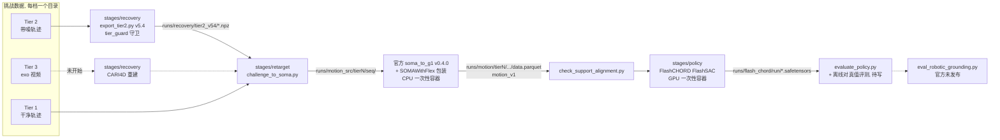

# 当前架构

描述**此刻**代码实际是什么样。它与 ADR 描述的目标之差，就是 roadmap 的输入。

> 状态：代码均未 commit（工作树里未跟踪），等团队确认框架。三份相关 ADR 为 Proposed：
> [00001 训练栈](adr/00001-training-stack.md)、[00002 档位隔离](adr/00002-tier-isolation.md)、
> [00003 环节交接与运行方式](adr/00003-stage-handoff-and-runtime.md)。

## 现状一览

| 环节 | 代码 | 状态 |
|---|---|---|
| 共用层 `libs/v2d_infra` | `paths.py`、`soma_fk.py`（FK 唯一入口，带磁盘缓存）、`add_metrics.py`（ADD-AUC）、`tier_guard.py`（档位隔离守卫） | 可用，有测试 |
| `stages/recovery` | `export_tier2.py`（v5.4 净室降噪，提交用）、`cleanroom_params.py`、`t2core.py`（不读数据的纯函数）、`v51.py`、`nopen.py`；其余 `*.py` 是分析脚本 | Tier 2 可用；Tier 3 未开始 |
| `stages/retarget` | `challenge_to_soma.py`、`soma_flex.py`（官方读取器的包装）、`run_soma_to_g1.py`、`check_support_alignment.py`、`batch.sh`/`one.sh` | 两档 60 条已批量跑通 |
| `stages/policy` | `fc_train.sh`（FlashCHORD）、`smoke_recon_body.sh`（Isaac Lab） | 只跑过冒烟，无完整策略 |
| `stages/evaluate` | — | 未开始；暂用 FlashCHORD 自带 `evaluate_policy.py` |
| `scripts/dev` | `remote`（同步 + 远端执行）、`pull-results`、`incontainer`（Isaac 镜像一次性容器）、`in-flash-chord`、`build-flash-chord` | 可用 |

## 数据流

每条实线是一次落盘，下游只读上游产物文件，不 import 上游代码。

## 运行环境

| 位置 | 用途 |
|---|---|
| Mac（仓库工作树） | 编辑代码、文档、agent 指挥；`scripts/dev/remote` 把工作树 rsync 到训练机后执行 |
| 训练机（共用，1× RTX 4090 24 GB，22 核） | 数据、`runs/`、容器；`data/` `runs/` `results/` 受 rsync 保护，`results/` 单向回流 |
| 镜像 `robotic-grounding:latest` | Isaac Lab 2.3.2 + 官方 toolkit；跑重定向与 Isaac Lab 训练 |
| 镜像 `flash_chord:latest`（22 GB） | FlashCHORD（Newton / Warp / JAX）；跑 FlashSAC 训练与评测 |
| 租用 L40S 48 GB（待批） | FlashCHORD 满配训练（replay buffer 1000 万条需 >24 GB） |

容器一律一次性（`--rm`），整仓挂到 `/repo`：parquet 里的网格路径写的是 `/repo/...`。

## 对外依赖

| 依赖 | 用途 | 状态 |
|---|---|---|
| HF `nvidia/video_to_data_challenge` track_2 | Tier 1、Tier 2 数据 | 已下载；Tier 3 无现成重建，需自行从视频做 |
| `nvidia-isaac/video_to_data` v0.4.0（33129dd） | 重定向、FlashCHORD、Isaac Lab 任务、重建模块 | 本地 checkout 在 `third_party/`，源码不改 |
| py-soma-x 0.2.1 | SOMA-X 人体模型 | 宿主机与容器内版本一致 |

## 已知缺口

- **官方评测脚本 `eval_robotic_grounding.py` 未发布**；排行榜以哪套训练栈、按什么播放速度评测，官方未说明。
- **本地评测口径**：`evaluate_policy.py` 对照策略自己的参考轨迹；Tier 2/3 需要对 Tier 1 真值的离线评测。
  对应 roadmap 候选"本地评测与官方评测的关系"，ADR 未写。
- **实验记录形态**：`runs/` 目录约定已在用，但"每次运行必须落盘哪些元数据"没有成文。ADR 未写。
- **Tier 3** 整条链路未开始（视频 → 掩码 → 相机标定 → FoundationPose/CARI4D → 轨迹）。
- **契约表全空**：`docs/contracts/` 各面尚无条目；已有测试（`test_tier_guard.py`、`test_soma_flex.py`、
  `test_challenge_to_soma.py`、`test_soma_fk.py`）在 docstring 里写明"暂无契约 ID"。
- Tier 2 物体在桌面上时，不穿地约束不覆盖桌面（两条序列陷入约 2 cm）。

## 变更记录

- 2026-09-23：初稿。
- 2026-09-25：按实际代码重写：现状一览、数据流、运行环境、依赖、缺口；链接三份 Proposed ADR。
