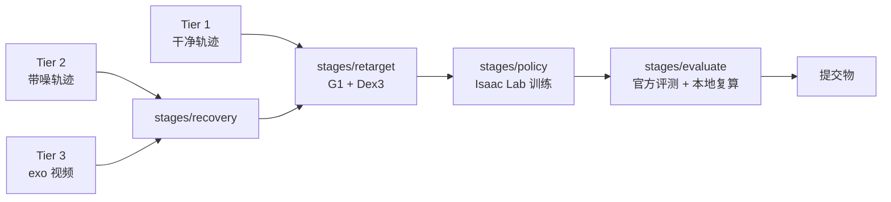

# 当前架构

描述**此刻**代码实际是什么样。它与 ADR 描述的目标之差，就是 roadmap 的输入。

## 现状

尚无代码。仓里只有目录骨架与文档（P0）。

## 目标数据流

下图是 `CLAUDE.md` 里目录划分对应的数据流，尚无任何一段已实现。

每条边是一次落盘，下游只读上游的产物文件。共用的 schema 与档位寻址在
`libs/v2d_infra`。

## 对外依赖

| 依赖 | 用途 | 状态 |
|---|---|---|
| [HF: nvidia/video_to_data_challenge](https://huggingface.co/datasets/nvidia/video_to_data_challenge/tree/main/track_2) | Track 2 数据集 | 未下载；目前只发布了 Tier 1、Tier 2 |
| [nvidia-isaac/video_to_data @ release/0.2.0](https://github.com/nvidia-isaac/video_to_data/tree/release/0.2.0/) | 官方 toolkit：重定向、Isaac Lab 任务、RSL-RL 训练 | 未接入 |
| Isaac Lab（toolkit 标注 2.3.1） | 仿真与 RL | 未安装 |

## 已知缺口

- 官方评测脚本 `eval_robotic_grounding.py` 在 release/0.2.0 的公开内容里尚未找到，
  位置待核对。
- Tier 3 数据尚未在数据集中出现。
- 指标（AUC / SP-SR / MP-SR / MPPE）的定义尚未核对。

## 变更记录

- 2026-09-23：初稿。
