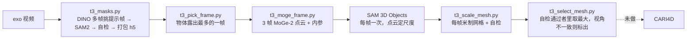

# stages/recovery/tier3

Tier 3 的轨迹重建：从 exo 视频（`observation.images.exo_camera`，三档逐字节相同）出发，用官方 toolkit 的
Grounding DINO、SAM2、MoGe-2、SAM 3D Objects 和 CARI4D 重建人体与物体，最后落成与 Tier 2 同 schema 的档目录，
交给 `stages/retarget`。现在做到 CARI4D 之前：每集有自动掩码和米制物体网格，CARI4D 及其后的转换还没做。

## 三条规则

- **不读 Tier 1。** 输入目录只放 exo 视频、`ground_plane/` 和 `meta/` 里的 `episodes.jsonl`、
  `episodes_metadata.jsonl`、`tasks.jsonl`、`info.json`；不放轨迹 parquet，也不放 `episodes_stats.jsonl`（它是轨迹统计）。
  脚本拒绝任何含 `tier_1` 的路径。
- **全自动，不人工标注。** Kaggle Foundational Rule 4.b 禁止对测试数据做 hand labeling；这 30 段视频就是
  Tier 3 的测试数据。检测不到物体的集写 `NO_AUTO_PROMPT` 并失败，不补框；叠色图只用来诊断规则，不用来放行单集。
- **不读 Track 2 网格。** 物体网格由 SAM 3D Objects 从单帧生成，尺度来自同一帧的 MoGe-2 点云。

## 在哪跑

lab 的 L40S（ml40）。宿主侧脚本用官方 toolkit 的 venv（Python 3.10，`/lab_data/yqchen/v2d/venv`，toolkit 以
editable 方式装在 `/lab_data/yqchen/v2d/video_to_data`）；`t3_moge_frame.py`、`moge_ground_probe.py` 在
`v2d_cari4d` 镜像里跑（它带 CARI4D 钉住版本的 MoGe-2）。工作目录 `/lab_data/yqchen/v2d/tier3/`：
`input/`（只读输入）、`runs/work/epNN_<object>/`（每集产物）、`logs/`、`code/`（本目录与
`libs/v2d_infra/tier_guard.py` 的部署副本，`code/DEPLOYED` 记 commit）。路径可用环境变量 `T3_ROOT`、`T3_PY`、
`T3_WEIGHTS` 覆盖，每集的 SAM3D 帧数用 `T3_MESH_FRAMES`（默认 3）。

这一目录不属于 uv 管理的包（它跑在 toolkit 的 3.10 venv 与容器里），所以保留 `from __future__ import annotations`。

## 每集的流程

| 文件 | 作用 |
|---|---|
| `t3_queue_mesh.sh` | 30 集串行队列；每步用 GPU 前等空闲显存 ≥ 20 GB，给 FlashCHORD 让卡 |
| `t3_masks.py` | 掩码。由 Track 1 的掩码脚本改来，自检规则见脚本头注释 |
| `t3_mesh_ep.sh` | 单集：取帧 → MoGe 点云 → SAM3D → 米制网格 |
| `t3_run.py` | 官方 docker wrapper 的启动器：代理只以变量名（`-e KEY`）转进容器，口令不进命令行与日志 |
| `t3_scale_mesh.py` | SAM3D 结果 × 尺度 → `object_scaled.glb`；自检投影框 IoU 与深度比 |
| `t3_select_mesh.py` | 每集从多帧结果里选一个网格，写 `sam3d_out/object_scaled.glb` 与汇总的 `scale_report.json` |
| `moge_ground_probe.py` | 世界系探针：MoGe 地面与发布的 `ground_plane` 比较（30 集，结果见下） |
| `probe_mask_check.py` | 掩码自检的注入缺陷测试：真实掩码要过，桌面形状与远角掩码要被拒 |

## 当前结果（2026-10-09，L40S）

- 世界系探针：MoGe 地面法向与发布平面夹角 2.2–3.8°（主要是俯仰），MoGe 估的相机高度比发布值短 1–11%，fx ≈ 820 px。
- 第一批 30 集（单帧网格，`logs/t3_queue.log`）：掩码 29/30 过；网格自检 25/29 过。自检过了但形状可疑的至少两集：
  ep14 圆桌只生成了桌面圆盘，ep01 吸尘器尺寸不对。
- 第二版（掩码规则改为检测框一致 + 不外溢，网格改为 3 帧）在 ep05、ep14 上试：ep05 大黑箱掩码转为通过，3 帧网格一致
  （0.54×0.90×0.41 m）；ep14 仍是圆盘，3 帧都一样，因为 SAM2 整段只分割了桌面、没分到立柱和底座，多帧一致性查不出这种
  掩码层面的缺口。
- **计分对物体局部坐标系敏感**：kit 的 Track 2 计分（`metric_code/track_2/*.py`，`_ALIGN_INITIAL_POSE = False`）直接比
  每帧物体位姿的平移与四元数，ADD 用官方网格顶点；打包器只做世界系的左乘对齐（`pack_submission.py`
  `convert_track2_frame`）。rollout 里的物体位姿是我们这份网格的局部系，它和官方网格的局部系差多少，位姿误差就差多少。
  用自生成网格意味着每集带一个未知的常量局部变换误差。
